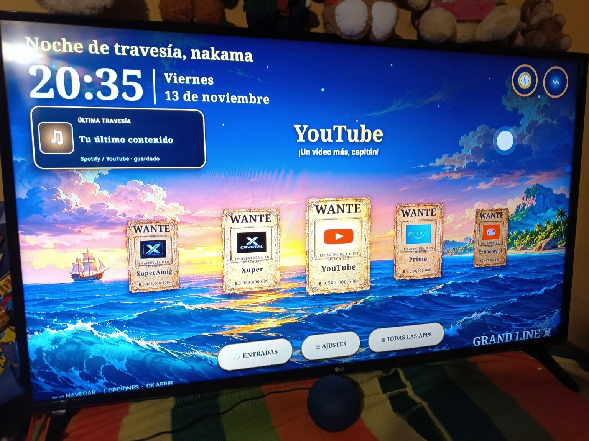
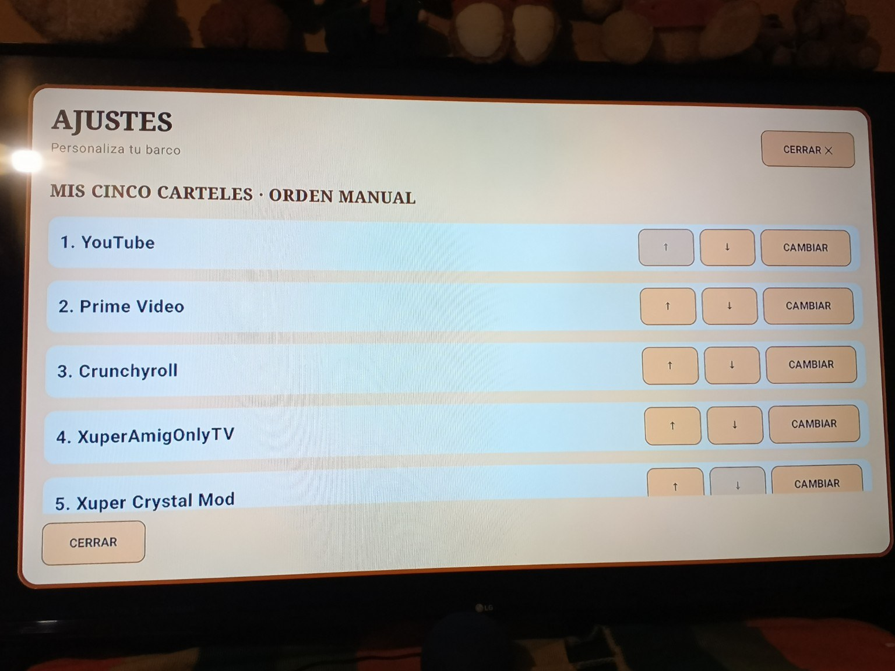

# ☠️ GRAND LINE V6

### Navega tu Fire TV como un verdadero nakama

**Launcher personalizado para Android TV y Amazon Fire TV, inspirado en
el universo de One Piece.**


**Kotlin · Jetpack Compose · Android TV · Amazon Fire TV**

------------------------------------------------------------------------

## 🌊 ¿Qué es GRAND LINE V6?

GRAND LINE V6 es un launcher alternativo diseñado para darle una nueva
identidad a la pantalla principal de Android TV y Amazon Fire TV. Su
interfaz toma inspiración visual del mundo de **One Piece**: carteles
WANTED, recompensas en berries, navegación pirata y un ambiente de
aventura.

El proyecto está pensado para televisores y controles remotos,
priorizando una interfaz visual, navegación mediante D-pad y acceso
rápido a las aplicaciones instaladas.

## 🏴‍☠️ Características principales

- **Cinco carteles WANTED:** carrusel con las aplicaciones principales.
- **Orden manual:** organiza los cinco carteles desde los ajustes del
  launcher.
- **Recompensas en berries:** cada cartel tiene una recompensa visual.
- **Todas las aplicaciones:** cuadrícula para explorar y abrir las
  aplicaciones instaladas.
- **Reproductor multimedia:** panel preparado para sesiones multimedia
  compatibles.
- **Ambiente dinámico:** fondos de día, atardecer y noche.
- **Navegación con control remoto:** interfaz diseñada para D-pad,
  selección y retroceso.
- **Accesos rápidos:** opciones para ajustes del dispositivo y red.

## 📺 Capturas en funcionamiento

### Pantalla principal

Los cinco carteles destacados y los accesos principales del launcher.



### Ajustes del launcher

Organiza los cinco carteles principales y cambia las aplicaciones
destacadas.



### Todas las aplicaciones

Explora las aplicaciones instaladas desde una cuadrícula y selecciona
cuál quieres abrir.


## 🛠️ Tecnologías

- Kotlin
- Jetpack Compose
- Android SDK
- Android TV / Amazon Fire OS
- Android MediaSession y servicios multimedia compatibles

## 💻 Requisitos de desarrollo

- Android Studio.
- JDK compatible con la configuración Gradle del proyecto.
- Android SDK instalado.
- Dispositivo Android TV / Amazon Fire TV o emulador compatible.

## 🚀 Instalación

1.  Clona el repositorio:

    ``` bash
    git clone https://github.com/brayancalderon-dev/OnePieceLauncherTv.git
    ```

2.  Abre la carpeta del proyecto desde Android Studio.

3.  Espera a que Gradle complete la sincronización.

4.  Selecciona un dispositivo Android TV / Fire TV conectado o un
    emulador.

5.  Ejecuta la configuración `app`.

## 📌 Estado del proyecto

**En desarrollo.**

GRAND LINE V6 se está probando en un entorno Android TV y en un Amazon
Fire TV Stick. Algunas integraciones dependen de las capacidades,
permisos y restricciones de Fire OS, así como de las aplicaciones
instaladas.

## 🏴‍☠️ Créditos

Proyecto personal de desarrollo de un launcher para Android TV / Amazon
Fire TV, con una interfaz temática inspirada en **One Piece**.

------------------------------------------------------------------------

### ¡Zarpa hacia una nueva aventura, nakama! ☠️
